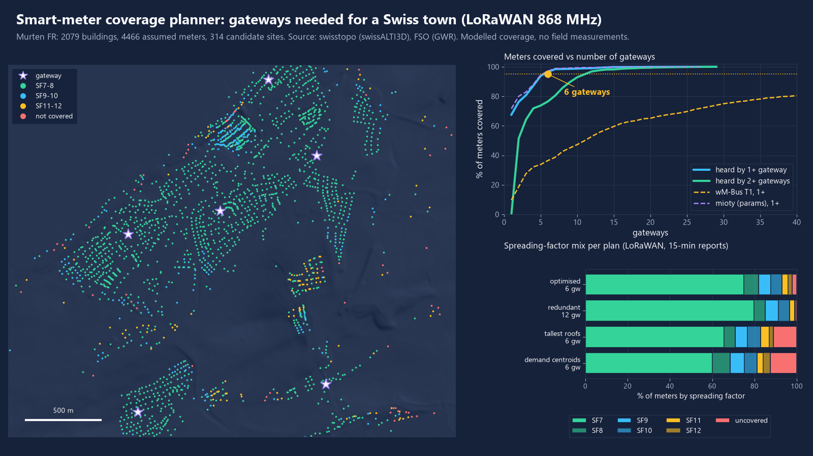
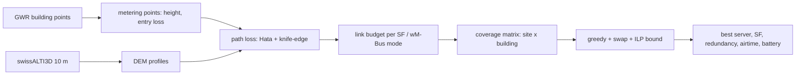

# meter-comm-coverage-planner

Open-source radio coverage and gateway placement planner for utility smart-meter networks (LoRaWAN and wM-Bus at 868 MHz, mioty as a parameter set), built on Swiss open geodata.



*Murten FR, 2,079 buildings with 4,466 assumed meters. Modelled coverage with stated assumptions; no field measurements.*

Swiss grid operators have to bring 80% of their metering points to smart meters by the end of 2027 (StromVV, SR 734.71, Art. 31e para. 1: within ten years of the amendment of 1 November 2017, in force since 1 January 2018, 80% of all metering devices in a grid area must be smart metering systems; checked in the consolidated text of 1 July 2026 on fedlex). Many of those meters sit in cellars. This tool answers: where do I put N gateways, how many meters does that reach, with how much redundancy, and what does it do to spreading factors, airtime and battery life.

## What it does

- Reads building points (federal building register) and a terrain model, both open data from geo.admin.ch.
- Builds candidate gateway sites: the tallest rooftop per 150 m cell (+2 m mast) and a 250 m grid of 10 m poles.
- Computes path loss from every candidate to every building: Okumura-Hata (urban, suburban, open) or COST-231 or free space, plus a terrain diffraction check along the DEM profile (ITU-R P.526 knife edge, Deygout 3-edge and Epstein-Peterson), plus entry loss for the meter location (indoor, cellar).
- Applies a link budget per technology: LoRaWAN SF7 to SF12, wM-Bus T1 and C1, mioty as an editable parameter set.
- Chooses gateway sites: greedy maximum coverage with a redundancy bonus, a swap local search, and an exact ILP (HiGHS) as a bound check.
- Reports per building best server, spreading factor and redundancy; per gateway load; airtime, duty-cycle headroom, collision estimate and battery life.
- Writes GeoJSON (WGS84), a PNG map, a gateway CSV and a Markdown report.

## Results

Run on the bundled Murten fixture, base assumptions: Hata suburban + Deygout, 8 dB fade margin, 15 dB entry loss indoor, 30 dB in cellars (50% of buildings, assumed), one 12-byte uplink per meter every 15 minutes. Everything below is modelled. Reproduce with `python -m meter_coverage demo` (about 5 minutes, of which 106 s is terrain diffraction for 653,000 links; `--no-ilp` skips the 3 minutes of ILP).

| Measured | Value |
|---|---|
| Gateways for 80 / 90 / 95 / 99% of meters (LoRaWAN, greedy) | 3 / 5 / 6 / 12 |
| 6 optimised sites (greedy + swap): meters covered / heard by 2+ gateways | 97.7% / 75.5% |
| Gateways for 95% with every covered meter heard by 2+ | 12 |
| Same 6 gateways on the tallest rooftops / at demand centroids | 88.8% / 87.5% covered |
| 300 random 6-site sets | 70.1% covered on average (p10 52.6%, p90 83.8%) |
| Spreading factor mix, 6 optimised sites | SF7 74.9%, SF8 7.0%, SF9 5.9%, SF10 5.1%, SF11 3.0%, SF12 1.8%, uncovered 2.3% |
| Airtime per uplink (mean) / duty-cycle headroom (worst meter, 1% limit) | 0.142 s / 83.5% |
| Estimated battery life, median / 10th percentile meter (one 2.6 Ah cell, 15 min) | 21.2 y / 8.0 y |
| Pure-ALOHA delivery, mean / worst gateway (3 channels) | 97.2% / 95.5% |
| Gateways for 80% of meters, wM-Bus T1 / C1 (same assumptions) | 40 / 56 (95% not reached with 60) |
| Gateways for 95%, mioty parameter set | 6 (assumed -139 dBm sensitivity) |
| Greedy+swap vs ILP upper bound (3 / 6 / 12 sites, 60 s limit) | within 2.6% / 2.5% / 0.1% |
| Runtime: terrain diffraction / greedy 60-step curve / swap search | 106 s / 0.02 s / 0.01 s |

Gateways needed for 95% (LoRaWAN) depend strongly on the propagation model and on entry loss. Model against model, and sensitivity to penetration loss (no field data to choose between them):

| Scenario | Gateways for 95% | For 95% with 2+ |
|---|---|---|
| Hata open + Deygout | 3 | 4 |
| Hata suburban, no terrain | 4 | 7 |
| Hata suburban + Deygout (base) | 6 | 12 |
| Hata suburban + Epstein-Peterson | 7 | 11 |
| Hata urban + Deygout | 12 | 24 |
| COST-231 (extrapolated to 868 MHz) + Deygout | 16 | 31 |
| Cellar loss 20 / 30 / 40 dB (base model) | 3 / 6 / 11 | 6 / 12 / 24 |

72.7% of gateway-building links have some DEM obstruction. Where obstructed, Deygout gives 22.7 dB on average against 20.1 dB for Epstein-Peterson (mean absolute difference 6.0 dB). Full tables: [docs/results.md](docs/results.md), raw numbers in [docs/results.json](docs/results.json).

Outputs for the base plan are in `docs/`: [coverage.geojson](docs/coverage.geojson), [coverage_map.png](docs/coverage_map.png), [gateways.csv](docs/gateways.csv).

## Quick start

```bash
python -m venv .venv && . .venv/bin/activate      # Windows: .venv\Scripts\activate
pip install -e ".[dev]"
python -m meter_coverage demo --out output          # reproduces the numbers above
python -m meter_coverage plan --tech lorawan --target 0.95 --env suburban --cellar-db 30 --out output/plan
python -m pytest -q
```

Other towns: `pip install -e ".[fetch]"`, edit the bounding box in `scripts/fetch_data.py`, run it, and pass `--buildings`/`--dem` to `plan`.

## How it works



- **Path loss** = max(Hata, free space) at the horizontal distance, with the gateway at roof or pole height and the meter at 1.5 m, plus terrain diffraction from the DEM profile (100 samples, 4/3 earth radius), plus entry loss. Hata already contains an average clutter effect, the DEM is bare earth, so buildings and trees are not modelled individually.
- **Link budget** = 14 dBm meter power, -2 dBi meter antenna, +5 dBi gateway antenna, 1 dB cable, 8 dB fade margin, sensitivity per mode. Maximum path loss including entry loss: 131 dB (SF7) to 145 dB (SF12), 113 dB (wM-Bus T1), 147 dB (mioty set).
- **Objective**: sum over buildings of meters x (1 if heard once + 0.5 if heard twice). Monotone submodular, so greedy has the usual (1 - 1/e) guarantee; the swap search and the ILP check how much is left.
- **Airtime** by the standard LoRa time-on-air formula, **duty cycle** against the 1% sub-band (0.1% for the wM-Bus sub-band), **collisions** by pure ALOHA per spreading factor and channel, **battery** from average current (TX, two receive windows, sleep, 1%/year self-discharge).

## Data sources

- Buildings: Federal Statistical Office FSO, Federal Register of Buildings and Dwellings (GWR), via the geo.admin.ch identify service (layer `ch.bfs.gebaeude_wohnungs_register`), fetched 2026-11-08. Building points, not footprints; addresses are not kept. Fixture: `data/murten_buildings.csv` (2,079 buildings used of 3,196 existing or planned entries).
- Terrain: swisstopo swissALTI3D (2019 tiles, 2 m averaged to 10 m), via data.geo.admin.ch. Fixture: `data/murten_dem_10m.npz`.
- Terms: swisstopo and FSO open government data, free use including commercial with source attribution, see [geo.admin.ch terms of use](https://www.geo.admin.ch/en/general-terms-of-use-fsdi). "Source: Federal Office of Topography swisstopo; Federal Statistical Office FSO."
- Meters per building: number of dwellings in the register, or 1 for non-residential buildings of at least 40 m2 that are not outbuildings. This is an assumption, not meter data.
- References: Hata (1980) IEEE Trans. Veh. Technol. 29(3); COST 231 Final Report (1999); ITU-R P.526 (diffraction); Deygout (1966); Epstein and Peterson (1953); ITU-R P.2109 (building entry loss); LoRa modem datasheet-class sensitivities and the published LoRa time-on-air formula; EN 13757-4 (wM-Bus); ETSI TS 103 357 (mioty); ETSI EN 300 220 / ERC Rec 70-03 (duty cycle).

## What is not verified yet

- No field measurements. Models are compared with each other only; the spread (3 to 16 gateways for 95%) shows how much the result depends on the choice.
- Entry loss values (15 dB indoor, 30 dB cellar, 50% of meters in cellars) are assumptions in the range commonly quoted for sub-GHz; they are inputs, not results.
- Hata is used outside its formal range (rooftop gateways below 30 m, distances under 1 km); COST-231 is extrapolated from 1.5-2 GHz down to 868 MHz. Both are comparison models, not validated here.
- The DEM is bare earth. Buildings, trees and street canyons are only in the clutter class, so shadowing by other buildings is not modelled; no shadow-fading draw, only a fixed margin.
- Uplink only. Downlink, confirmed messages, gateway backhaul and interference from other networks are not modelled. Collisions are pure ALOHA without capture or SF imperfection.
- wM-Bus sensitivities (-105 / -102 dBm), mioty airtime (0.7 s) and sensitivity (-139 dBm) and all battery currents are datasheet-class assumptions.
- Candidate sites are generated, not checked for ownership, roof access, mains or backhaul. Rooftop height is storeys x 3 m + 2 m.
- One town, 10 m terrain, building points rather than footprints. The meters-per-building rule is a guess.
- The ILP is time-limited (60 s) and did not always beat the swap search; its bound is reported, not an optimum.

## Licence

MIT, see [LICENSE](LICENSE). Data are under the open government terms above.
